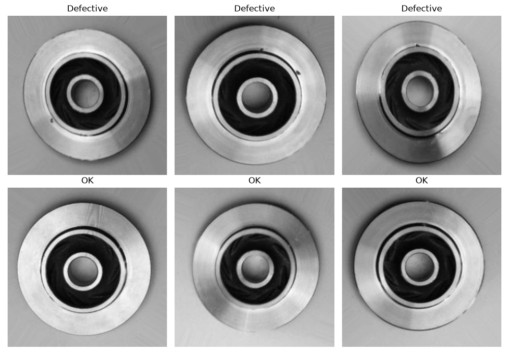
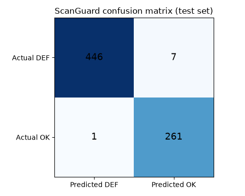

# ScanGuard: AI Quality Inspection for Industrial Castings

ScanGuard classifies photos of cast metal parts as **DEFECTIVE** or **OK**. In inspection, the costly mistake is a missed defect: a faulty part that reaches a customer. ScanGuard is tuned to keep that error as low as possible, and it flags borderline cases for a human to check.

It ships as a trained model, a command-line tool, a Streamlit inspection app, a FastAPI service and a Docker image.



---

## Results

Test set: 715 images the model never saw during training or tuning (453 defective, 262 OK). Defective is the positive class.

| Decision threshold | Missed defects | False alarms | Accuracy | Precision | Recall |
|---|---|---|---|---|---|
| 0.50 (default) | 8 | 1 | 98.7% | 99.8% | 98.2% |
| **0.35 (tuned)** | **4** | **2** | **99.2%** | **99.6%** | **99.1%** |

Lowering the threshold from 0.50 to 0.35 **halved the missed defects (8 to 4)** in exchange for one extra false alarm. In inspection that's the right trade: a false alarm costs a second look, while a missed defect costs a faulty part shipped.



---

## How it works

**Data.** The [Real-life Industrial Dataset of Casting Product](https://www.kaggle.com/datasets/ravirajsinh45/real-life-industrial-dataset-of-casting-product) from Kaggle: 7,348 top-view images of submersible pump impellers. The training folder is split 90/10 into training (5,970) and validation (663) with a fixed seed, and the 715 test images are kept separate.

**Model.** ResNet18 pretrained on ImageNet, used for transfer learning. The pretrained layers are frozen and only a new final layer (512 → 2 classes) is trained, using Adam (learning rate 0.001) and cross-entropy loss for 3 epochs on a CPU. Images are resized to 224×224 and normalised with ImageNet statistics.

| Epoch 3 | Value |
|---|---|
| Training loss | 0.1046 |
| Training accuracy | 97.4% |
| Validation accuracy | 98.3% |

**Threshold tuning without leakage.** The model outputs a defect probability. Instead of using the default 0.50 cut-off, `threshold.py` tries thresholds from 0.50 down to 0.05 **on the validation set only** and picks the one with the highest recall while keeping precision at or above 97%. That gave 0.35, which is saved to `threshold.txt`. The test set was used only once, for the final results above.

**Input check.** The model only knows castings, so it would still give a confident answer for a random photo. Before predicting, ScanGuard checks that an image looks like an inspection photo (nearly square and almost colourless). Anything else is rejected instead of being given a misleading prediction.

**Manual-review band.** In the Streamlit app, predictions with a defect probability between 0.20 and 0.60 are flagged for a human to check.

---

## Project structure

| File | Purpose |
|---|---|
| `download_data.py` | Downloads the dataset from Kaggle |
| `explore_data.py`, `view_samples.py` | Look at folder structure and sample images |
| `data_loader.py` | Transforms, train/validation/test split, data loaders |
| `model.py` | ResNet18 with a new 2-class output layer |
| `train.py` | Trains the model and saves `scanguard_model.pth` |
| `evaluate.py` | Test-set metrics, misclassified files, `confusion_matrix.png` |
| `threshold.py` | Tunes the decision threshold on validation data, writes `threshold.txt` |
| `predict.py` | Loads the model, input check, single-image prediction (also a CLI) |
| `app.py` | Streamlit inspection app |
| `api.py` | FastAPI service |
| `Dockerfile` | Container for the API (CPU-only PyTorch) |

---

## Run it yourself

### 1. Set up

```bash
git clone https://github.com/Bhawani-Lal/scanguard.git
cd scanguard
python -m venv venv
venv\Scripts\activate          # Windows; use: source venv/bin/activate on Linux/Mac
pip install torch torchvision
pip install -r requirements.txt
pip install streamlit kagglehub matplotlib
```

### 2. Get the data

```bash
python download_data.py
```

This prints where Kaggle saved the dataset. Copy its inner `casting_data/casting_data` folder (the one containing `train` and `test`) into this project as `data/casting_data`.

### 3. Train, evaluate and tune

The trained weights are not stored in the repository, so create them first:

```bash
python train.py        # creates scanguard_model.pth
python evaluate.py     # test-set metrics and confusion_matrix.png
python threshold.py    # writes threshold.txt
```

### 4. Use it

**Command line**

```bash
python predict.py data/casting_data/test/def_front/cast_def_0_1059.jpeg
```

**Streamlit app**

```bash
streamlit run app.py
```

**API**

```bash
uvicorn api:app --reload
```

Then open http://localhost:8000/docs to try it in the browser.

| Endpoint | Description |
|---|---|
| `GET /health` | Service status |
| `POST /predict` | Upload an image and get a prediction |

Example response:

```json
{
  "filename": "cast_def_0_7.jpeg",
  "prediction": "DEFECTIVE",
  "defect_probability": 0.8971,
  "threshold": 0.35,
  "needs_manual_review": false
}
```

Errors: `400` if the file isn't a readable image, `422` if it doesn't look like a casting inspection photo.

### 5. Run with Docker

After training (so `scanguard_model.pth` exists):

```bash
docker build -t scanguard-api .
docker run -p 8000:8000 scanguard-api
```

Then open http://localhost:8000/docs.

---

## Limitations

- Trained on one product type (pump impellers) photographed from above in greyscale. Other parts or camera setups would need new training data.
- Only the final layer was trained, for 3 epochs on a CPU. Fine-tuning deeper layers could improve results further.
- The input check is a simple rule (shape and colour), not a learned out-of-distribution detector.
- Not yet tested on images from a live production line.

## Tech stack

Python, PyTorch, torchvision, Streamlit, FastAPI, Uvicorn, Docker
